# AWS Core Services: Complete Architecture Flow & Detailed Reference Guide

> **Source Material**: Derived and expanded from [aws.md](file:///d:/learning/aws.md) (comprehensive breakdown of the ~50 core AWS services structured around a production-grade, real-world web/e-commerce system).

---

## Table of Contents
1. [End-to-End Global Architecture Flow Diagram](#1-end-to-end-global-architecture-flow-diagram)
2. [Lifecycle of a Request (Step-by-Step Flow)](#2-lifecycle-of-a-request-step-by-step-flow)
3. [Domain 1: DNS & Global Traffic Management](#domain-1-dns--global-traffic-management)
4. [Domain 2: Static Content, Object Storage & Edge Caching](#domain-2-static-content-object-storage--edge-caching)
5. [Domain 3: Perimeter Security & Encryption](#domain-3-perimeter-security--encryption)
6. [Domain 4: API Ingress & Traffic Distribution](#domain-4-api-ingress--traffic-distribution)
7. [Domain 5: User Identity, Authentication & Authorization](#domain-5-user-identity-authentication--authorization)
8. [Domain 6: Compute Services Layer](#domain-6-compute-services-layer)
9. [Domain 7: Compute-Attached Storage (Block & File)](#domain-7-compute-attached-storage-block--file)
10. [Domain 8: Configuration & Secrets Management](#domain-8-configuration--secrets-management)
11. [Domain 9: Databases & In-Memory Data Stores](#domain-9-databases--in-memory-data-stores)
12. [Domain 10: Asynchronous Messaging & Workflow Orchestration](#domain-10-asynchronous-messaging--workflow-orchestration)
13. [Domain 11: Artificial Intelligence & Machine Learning (AI/ML)](#domain-11-artificial-intelligence--machine-learning-aiml)
14. [Domain 12: Big Data, Analytics & Streaming Ingestion](#domain-12-big-data-analytics--streaming-ingestion)
15. [Domain 13: Monitoring, Logging, Observability & Governance](#domain-13-monitoring-logging-observability--governance)
16. [Domain 14: CI/CD & Infrastructure as Code (IaC)](#domain-14-cicd--infrastructure-as-code-iac)
17. [Domain 15: Developer Productivity, Tooling & Modern AI Assistance](#domain-15-developer-productivity-tooling--modern-ai-assistance)
18. [Domain 16: Cloud Networking & Security Isolation](#domain-16-cloud-networking--security-isolation)
19. [Quick Reference Matrix: All ~50 Services at a Glance](#19-quick-reference-matrix-all-50-services-at-a-glance)

---

## 1. End-to-End Global Architecture Flow Diagram

The following diagram illustrates how all AWS service families interconnect to deliver a highly available, secure, scalable, and observable application (e.g., an enterprise e-commerce system like Amazon.com).

```mermaid
flowchart TD
    %% Global Users & Edge
    subgraph EDGE_LAYER ["1. Edge & Perimeter Security Layer"]
        User(["Client Browser / Mobile App"])
        R53["Route 53\n(Global DNS & Health Checks)"]
        WAF["AWS WAF\n(SQLi, XSS, Bot Control)"]
        SHIELD["AWS Shield\n(DDoS Protection)"]
        ACM["ACM\n(SSL/TLS Certificates)"]
        CF["CloudFront CDN\n(Edge Caching Worldwide)"]
        S3_Static["Amazon S3\n(Static Assets: HTML/CSS/JS/Media)"]
    end

    %% Ingress & Auth
    subgraph INGRESS_LAYER ["2. Ingress & Authentication Layer"]
        ALB["Application Load Balancer (ALB)\n(Path Routing, Stickiness, EC2/ECS)"]
        APIGW["API Gateway\n(REST / WebSockets, Throttling, Serverless)"]
        COGNITO["Amazon Cognito\n(User Pools, AuthN/AuthZ, JWT Tokens)"]
    end

    %% Compute Layer
    subgraph COMPUTE_LAYER ["3. Compute Layer (Within Isolated VPC)"]
        LAMBDA["AWS Lambda\n(Serverless Microservices)"]
        ECS_FARGATE["ECS / Fargate\n(Managed Container Tasks)"]
        EKS["EKS (Kubernetes)\n(Container Clusters)"]
        EC2["EC2 Instances\n(Virtual Machines / Autoscaling Groups)"]
        LIGHTSAIL["Lightsail\n(Simple All-In-One VPS / Blueprints)"]
        
        %% Storage & Config
        EBS[("EBS Volume\n(Dedicated SSD)")]
        EFS[("EFS\n(Shared NFS)")]
        SECRETS["Secrets Manager\n(API Keys & Credentials)"]
        APPCONFIG["AWS AppConfig\n(Feature Flags & Dynamic Config)"]
    end

    %% Data & Cache Layer
    subgraph DATA_LAYER ["4. Persistence & Caching Layer"]
        %% Relational
        AURORA[("Amazon Aurora\n(Serverless / Scalable Relational)")]
        RDS[("Amazon RDS\n(MySQL, Postgres, Oracle, SQL Server)")]
        %% NoSQL & Specialized
        DYNAMO[("DynamoDB\n(Single-digit ms Key-Value)")]
        DOCDB[("DocumentDB\n(MongoDB Compatible)")]
        KEYSPACES[("Keyspaces\n(Managed Cassandra)")]
        NEPTUNE[("Amazon Neptune\n(Graph DB: Social / Fraud)")]
        OPENSEARCH[("OpenSearch\n(Full-Text & Fuzzy Search)")]
        DMS["DMS\n(Database Migration Service)"]
        %% Caches
        ELASTICACHE[("ElastiCache\n(Redis / Memcached In-Memory)")]
        MEMORYDB[("MemoryDB\n(Durable Redis with Transaction Log)")]
    end

    %% Async & Coordination
    subgraph ASYNC_LAYER ["5. Asynchronous Messaging & Workflows"]
        SNS["Amazon SNS\n(Pub/Sub Fan-out Topics)"]
        SQS["Amazon SQS\n(Message Queues & Dead-Letter Queues)"]
        EVENTBRIDGE["EventBridge\n(Event Bus, Rules & Schedulers)"]
        STEPFUNCTIONS["Step Functions\n(Visual State Machines / Sagas)"]
        MWAA["MWAA\n(Managed Apache Airflow DAGs)"]
    end

    %% Analytics & Data Lake
    subgraph ANALYTICS_LAYER ["6. Streaming, Big Data & Analytics"]
        KINESIS["Amazon Kinesis\n(Streams & Firehose Data Ingestion)"]
        S3_LAKE[("Amazon S3 Data Lake\n(Parquet / Raw Log Storage)")]
        GLUE["AWS Glue\n(Serverless ETL & Data Catalog)"]
        EMR["Amazon EMR\n(Spark / Hadoop / Iceberg Processing)"]
        ATHENA["Amazon Athena\n(Serverless SQL on S3)"]
        REDSHIFT[("Amazon Redshift\n(Petabyte Columnar Data Warehouse)")]
        QUICKSIGHT["Amazon QuickSight\n(BI Dashboards & Reports)"]
    end

    %% AI / ML
    subgraph AI_LAYER ["7. Artificial Intelligence & Machine Learning"]
        BEDROCK["Amazon Bedrock\n(Generative AI Foundation Models)"]
        SAGEMAKER["Amazon SageMaker\n(Model Training & Custom Inference)"]
        REKOGNITION["Rekognition\n(Computer Vision / Face / OCR)"]
        POLLY["Amazon Polly\n(Text-to-Speech)"]
        TRANSCRIBE["Amazon Transcribe\n(Speech-to-Text Diarization)"]
    end

    %% Observability & Governance
    subgraph GOVERNANCE_LAYER ["8. Observability, Security & Management"]
        CW["CloudWatch\n(Logs, Metrics, Alarms, Dashboards)"]
        CT["CloudTrail\n(Audit Trails for API Actions)"]
        CONFIG["AWS Config\n(Compliance Rules & Drift Tracking)"]
        XRAY["AWS X-Ray\n(End-to-End Distributed Tracing)"]
        IAM["AWS IAM & Identity Center\n(RBAC, Policies, Roles, SSO)"]
        VPC_INFRA["VPC / Subnets / NAT / PrivateLink / VPN\n(Network Isolation & Tunnels)"]
    end

    %% Flows
    User -->|1. Resolves Domain| R53
    R53 -->|2. Points to Edge| CF
    CF -->|Static Cache Miss| S3_Static
    User -->|3. HTTPS API Request| WAF
    WAF -.->|Protected by| SHIELD
    WAF -.->|Secured by| ACM
    WAF -->|4. Dynamic Traffic| APIGW
    WAF -->|4. Alternative Ingress| ALB

    User -.->|Authenticate / Get JWT| COGNITO
    COGNITO -.->|Validate JWT Token| APIGW

    %% Ingress to Compute
    APIGW -->|Trigger Lambda| LAMBDA
    APIGW -->|Direct Integration / Proxy| ECS_FARGATE
    ALB -->|Forward to Containers| ECS_FARGATE
    ALB -->|Forward to K8s Pods| EKS
    ALB -->|Forward to VM Instances| EC2

    %% Compute to Storage / Config
    EC2 --- EBS
    EC2 --- EFS
    ECS_FARGATE --- EFS
    LAMBDA -.->|Read Secrets| SECRETS
    LAMBDA -.->|Read Flags| APPCONFIG

    %% Compute to DB
    LAMBDA -->|Fast Lookups| DYNAMO
    ECS_FARGATE -->|Relational Queries| AURORA
    EC2 -->|Relational Queries| RDS
    LAMBDA -->|Search Queries| OPENSEARCH
    LAMBDA -->|Read/Write Microsecond Cache| ELASTICACHE
    LAMBDA -->|Durable In-Memory State| MEMORYDB
    DMS -.->|Migrate On-Premise Data| RDS

    %% Compute to Async
    LAMBDA -->|Publish Order Placed| SNS
    SNS -->|Fan-Out Event| SQS
    SQS -->|Pull & Process Worker| LAMBDA
    EVENTBRIDGE -->|Cron / Specific Time Triggers| LAMBDA
    STEPFUNCTIONS -->|Orchestrate Multi-Step Flow| LAMBDA
    STEPFUNCTIONS -->|Execute Task| ECS_FARGATE

    %% Streaming & Big Data
    EC2 & LAMBDA -->|Ingest Telemetry / Clickstream| KINESIS
    KINESIS -->|Firehose Batching| S3_LAKE
    GLUE -->|Crawl & Transform Catalog| S3_LAKE
    EMR -->|Heavy Batch Processing| S3_LAKE
    ATHENA -->|Ad-Hoc Serverless SQL| S3_LAKE
    S3_LAKE -->|Load Data| REDSHIFT
    REDSHIFT & ATHENA -->|Visualize Metrics| QUICKSIGHT

    %% AI Integration
    LAMBDA -->|LLM Prompts & RAG| BEDROCK
    LAMBDA -->|Predict with Custom Models| SAGEMAKER
    LAMBDA -->|Analyze Uploaded Media| REKOGNITION
    LAMBDA -->|Convert Audio to Text| TRANSCRIBE
    LAMBDA -->|Generate Audio Voice| POLLY

    %% Observability Across Systems
    COMPUTE_LAYER -.->|Send Logs & Metrics| CW
    COMPUTE_LAYER -.->|Emit Trace Spans| XRAY
    IAM -.->|Authorize Execution Roles| COMPUTE_LAYER
```



---

## 2. Lifecycle of a Request (Step-by-Step Flow)

To understand how these services work together, consider a user purchasing an item on an e-commerce platform:

1. **DNS Resolution & Edge Access**:
   The browser queries **Route 53** for `store.example.com`. Route 53 performs health checks and returns the IP of the closest **CloudFront** edge location (lowest latency).
2. **Static Asset Delivery**:
   The user's browser requests HTML, JavaScript, and CSS. CloudFront delivers cached copies in milliseconds. If cache misses occur, CloudFront pulls files from **Amazon S3**.
3. **Security Inspection**:
   When the user submits a login or API query, the request hits **AWS WAF** (Web Application Firewall). WAF evaluates rules against SQL injection, cross-site scripting (XSS), and malicious bot IPs, backed by **AWS Shield** against DDoS. **ACM** terminates SSL/TLS.
4. **Authentication**:
   The user signs in. **Amazon Cognito** validates user credentials from a User Pool, issues an identity token (JWT), and passes it back to the client.
5. **API Gateway & Rate Limiting**:
   Subsequent API calls include the JWT token in the `Authorization` header. **API Gateway** validates the token, enforces throttling limits, and routes the request directly to **AWS Lambda** (or through an **ALB** to an **ECS/Fargate** container).
6. **Business Logic & Configuration**:
   The Lambda function queries **AWS AppConfig** to check if a "10% Flash Sale" feature flag is active and fetches third-party payment keys securely from **AWS Secrets Manager**.
7. **Fast Caching & Persistence**:
   Lambda checks **ElastiCache / MemoryDB** for product stock count. If not in cache, it queries **DynamoDB** (for item catalog metadata) and writes an order record to **Amazon Aurora Serverless**.
8. **Asynchronous Order Processing (Decoupling)**:
   Instead of keeping the user waiting, Lambda publishes an `OrderPlaced` event to **Amazon SNS**, which fans out copies to:
   - An **SQS** queue consumed by the Inventory/Fulfillment service.
   - An **SQS** queue consumed by the Fraud Analytics service.
   - A **Step Functions** state machine that manages payment capture, invoice generation, and courier scheduling with built-in retries.
9. **Scheduled Communications**:
   **EventBridge Scheduler** is instructed to trigger a notification Lambda exactly 3 hours later to confirm shipping tracking with the customer.
10. **Analytics & Data Warehousing**:
    Transaction logs are streamed through **Kinesis Data Firehose** into an **S3 Data Lake**. **AWS Glue** catalogs the data schema, **Amazon Athena** executes ad-hoc SQL queries, and **Amazon QuickSight** displays real-time executive revenue dashboards.
11. **Continuous Observability**:
    Every API invocation is tracked by **AWS X-Ray** for latency profiling, and stdout logs are streamed to **CloudWatch Logs**. Any administrative infrastructure change is permanently captured in **CloudTrail**.

---

## Domain 1: DNS & Global Traffic Management

### 1. Amazon Route 53
- **Primary Function**: Highly available and scalable cloud Domain Name System (DNS) web service and domain registrar.
- **Key Capabilities**:
  - Domain registration and hosted zone management.
  - Health checks: Continuously pings backends (ALBs, web servers) and reroutes traffic away from failed endpoints.
  - Routing policies:
    - *Latency-based routing*: Directs requests to the AWS region that yields the fastest response time for the client.
    - *Geolocation / Geoproximity routing*: Routes traffic based on the physical location of the requester.
    - *Failover routing*: Active-passive automatic failover during regional disaster recovery.
    - *Weighted round-robin*: Distributes traffic for canary testing or blue/green deployments.
- **When to Use**: Essential for any custom domain hosted on AWS or requiring smart global traffic management.

---

## Domain 2: Static Content, Object Storage & Edge Caching

### 2. Amazon S3 (Simple Storage Service)
- **Primary Function**: Industry-leading object/blob storage system offering 99.999999999% (11 9s) durability.
- **Key Capabilities**:
  - Unlimited scalable storage for HTML, CSS, JavaScript, images, backups, and data lake files.
  - Native static website hosting.
  - Built-in event notifications: Direct triggers to Lambda, SQS, or SNS when objects are created, deleted, or restored.
  - Lifecycle policies: Automatically moves older data to cheaper cold storage tiers (S3 Standard $\rightarrow$ S3 Glacier $\rightarrow$ Glacier Deep Archive).
- **Pro-Tip**: Store static assets and raw data here, but never serve high-volume global traffic directly from S3 without CloudFront in front of it.

### 3. Amazon CloudFront
- **Primary Function**: Global Content Delivery Network (CDN) with hundreds of edge locations worldwide.
- **Key Capabilities**:
  - Caches static (S3) and dynamic content (API Gateway, ALB) close to end-users to reduce latency.
  - Automatic HTTPS acceleration and SSL termination.
  - Geo-restriction (allow/block specific countries).
  - Lambda@Edge / CloudFront Functions: Runs lightweight compute directly at edge locations for URL rewrites and auth headers.
- **When to Use**: Always pair CloudFront with S3 for web asset delivery and in front of dynamic APIs for global latency optimization.

---

## Domain 3: Perimeter Security & Encryption

### 4. AWS WAF (Web Application Firewall)
- **Primary Function**: Layer 7 firewall protecting web applications and APIs from common web exploits and bots.
- **Key Capabilities**:
  - Filters traffic against SQL Injection (SQLi), Cross-Site Scripting (XSS), and HTTP flood attacks.
  - Managed rule sets provided by AWS and third parties (e.g., OWASP Top 10 mitigation).
  - Rate-based rules: Blocks or CAPTCHAs IPs exceeding specified request thresholds within a 5-minute window.
  - Attaches directly to CloudFront, Application Load Balancers, API Gateway, and AWS AppSync.

### 5. AWS Shield
- **Primary Function**: Managed Distributed Denial of Service (DDoS) protection service.
- **Tiers**:
  - **AWS Shield Standard** (Free): Automatically protects all AWS customers at no additional charge against common Layer 3 and 4 attacks (SYN floods, UDP reflection).
  - **AWS Shield Advanced** ($3,000/month): Enterprise-grade protection covering Layer 7, 24/7 access to the AWS DDoS Response Team (DRT), and financial cost-spike protection (refunds for scaling charges incurred during an attack).

### 6. AWS Certificate Manager (ACM)
- **Primary Function**: Provisions, manages, and deploys public and private SSL/TLS certificates.
- **Key Capabilities**:
  - Free public SSL/TLS certificates for use with AWS integrated services (CloudFront, ALB, API Gateway).
  - Automated DNS validation and renewal via Route 53 (eliminates expired certificate outages).
  - Enables end-to-end encryption in transit (HTTPS).

---

## Domain 4: API Ingress & Traffic Distribution

### 7. Elastic Load Balancing (ELB / ALB)
- **Primary Function**: Distributes incoming application traffic across multiple targets (EC2 instances, ECS containers, Lambda functions, IP addresses).
- **Key Flavor - Application Load Balancer (ALB)**:
  - Operates at Layer 7 (HTTP/HTTPS).
  - Advanced path-based, host-based, and query-parameter routing (e.g., `/api/v1/orders` $\rightarrow$ Target Group A; `/api/v1/users` $\rightarrow$ Target Group B).
  - Native integration with Auto Scaling Groups to scale compute instances up and down automatically.
  - Support for sticky sessions (cookie-based affinity) and WebSockets.
- **When to Use**: Best when hosting long-running container services, monolithic EC2 servers, or microservices requiring URL path routing.

### 8. Amazon API Gateway
- **Primary Function**: Fully managed "front door" for creating, publishing, maintaining, monitoring, and securing serverless REST, HTTP, and WebSocket APIs at scale.
- **Key Capabilities**:
  - **Direct Service Integrations**: Can directly invoke AWS services (e.g., DynamoDB, SQS, Step Functions) without requiring an intermediate compute layer.
  - Native API throttling, rate limiting, and API key management for multi-tenant tiers.
  - Built-in request/response payload validation and transformation.
  - Seamless authentication integration with Amazon Cognito and custom Lambda authorizers.
- **ALB vs. API Gateway**:
  - Use **ALB** for high-volume, steady-state HTTP traffic hitting EC2 or ECS containers (cost is based on uptime + LCUs).
  - Use **API Gateway** for serverless architectures (Lambda), public developer APIs requiring rate limits/keys, and direct AWS service proxies.

---

## Domain 5: User Identity, Authentication & Authorization

### 9. Amazon Cognito
- **Primary Function**: Simple and secure customer identity and access management (CIAM).
- **Two Core Components**:
  1. **User Pools (Authentication - AuthN)**:
     - User directory that handles registration, login, multi-factor authentication (MFA), password recovery, and social login (Google, Apple, Facebook, SAML).
     - Returns standard JSON Web Tokens (JWT: ID token, Access token, Refresh token).
  2. **Identity Pools (Authorization - AuthZ)**:
     - Exchanges valid JWT tokens or external identity credentials for temporary, restricted AWS IAM credentials to access AWS resources directly (e.g., uploading to an S3 folder).
- **User Attributes & Roles**: Custom attributes (e.g., `role: "admin"`) can be injected into claims to control access down to specific API routes.

---

## Domain 6: Compute Services Layer

| Service | Compute Model | Abstraction Level | Best Use Cases |
| :--- | :--- | :--- | :--- |
| **AWS Lambda** | Serverless Functions (FaaS) | Highest (Upload code only) | Microservices, event processing, asynchronous webhooks, S3/SQS triggers. |
| **AWS Fargate** | Serverless Container Engine | High (Run containers without nodes) | Dockerized microservices, periodic jobs, batch processing without managing VMs. |
| **Amazon ECS** | Container Orchestration (AWS Native) | Medium | Running Docker containers natively in AWS with tight IAM & VPC integration. |
| **Amazon EKS** | Managed Kubernetes (K8s) | Medium | Enterprises standardized on Kubernetes toolchains, Helm charts, and multi-cloud pods. |
| **Amazon EC2** | Virtual Machines (IaaS) | Low (Full OS access) | Legacy applications, custom kernels, extreme CPU/GPU requirements, monolithic apps. |
| **AWS Lightsail** | Virtual Private Server (VPS) | Simplified ("EC2 for beginners") | Personal blogs, simple WordPress sites, prototypes, fixed monthly pricing. |

### Deep Dive: Compute Services
- **AWS Lambda**: Executes code in response to triggers. Auto-scales from 0 to thousands of concurrent executions. Charges only for compute duration rounded to the nearest millisecond.
- **Amazon ECS vs. EKS**: Choose ECS for simpler AWS-native container management; choose EKS if your organization requires open-source Kubernetes portability.
- **AWS Fargate**: The serverless execution layer for both ECS and EKS—eliminates the need to patch, size, or scale EC2 cluster instances.

---

## Domain 7: Compute-Attached Storage (Block & File)

### 10. Amazon EBS (Elastic Block Store)
- **Primary Function**: High-performance block storage volumes designed for 1:1 attachment to EC2 instances.
- **Characteristics**:
  - Acts like a virtual raw SSD/HDD.
  - Persists independently from the running lifecycle of the EC2 instance.
  - Highly optimized for low-latency, transactional I/O (databases, operating system boot disks).
  - Bound to a single Availability Zone (AZ).

### 11. Amazon EFS (Elastic File System)
- **Primary Function**: Serverless, elastic NFS (Network File System) that can be mounted concurrently to multiple compute resources.
- **Characteristics**:
  - Mounts across hundreds of EC2 instances, ECS/Fargate tasks, and Lambda functions simultaneously.
  - Automatically grows and shrinks as files are added or removed (no pre-provisioning).
  - Spans across multiple Availability Zones for high availability.
  - Ideal for shared content repositories, CMS installations (WordPress media), and shared data directories.

---

## Domain 8: Configuration & Secrets Management

### 12. AWS Secrets Manager
- **Primary Function**: Securely encrypts, stores, and programmatically retrieves database credentials, third-party API keys, and certificates.
- **Key Features**:
  - Automated credential rotation for RDS, Aurora, and DocumentDB without application downtime.
  - Fine-grained IAM policy access.
  - Protects credentials from ever being hardcoded into Git repositories or configuration files.

### 13. AWS AppConfig
- **Primary Function**: Creates, manages, and quickly deploys dynamic application configurations and feature flags.
- **Key Features**:
  - Feature Flags: Toggle features ON/OFF in real-time or roll out features to 10% $\rightarrow$ 50% $\rightarrow$ 100% of users without redeploying code.
  - Local Agent: Computes/EC2/Lambda can use local agent caching to avoid continuous network roundtrips.
  - Validation: Built-in JSON schema and Lambda-based validators to prevent bad configurations from breaking production.

---

## Domain 9: Databases & In-Memory Data Stores

```
                      ┌────────────────────────────────────────┐
                      │     AWS Database & Caching Matrix      │
                      └────────────────────────────────────────┘
                                           │
         ┌─────────────────────────────────┴─────────────────────────────────┐
         ▼                                                                   ▼
   [Relational (SQL)]                                                  [NoSQL & Specialized]
   • Amazon RDS (Multi-Engine)                                         • DynamoDB (Key-Value/Doc)
   • Amazon Aurora (Cloud-Native/Serverless)                           • DocumentDB (MongoDB)
                                                                       • Keyspaces (Cassandra)
                                                                       • Neptune (Graph)
                                                                       • OpenSearch (Full-Text/Logs)
                                                                       • ElastiCache (In-Memory Redis/Memcached)
                                                                       • MemoryDB (Durable Redis)
```

### Relational Databases
1. **Amazon RDS (Relational Database Service)**:
   - Managed deployment for MySQL, PostgreSQL, MariaDB, Oracle, and Microsoft SQL Server.
   - Features: Multi-AZ automated failover, automated point-in-time backups, read replicas.
2. **Amazon Aurora**:
   - Cloud-native relational database engineered by AWS, fully compatible with MySQL and PostgreSQL.
   - Up to 5x faster than standard MySQL; replicates 6 copies of data across 3 Availability Zones.
   - **Aurora Serverless**: Automatically starts up, shuts down, and scales capacity based on application demand down to zero cost when idle.

### NoSQL & Specialized Databases
3. **Amazon DynamoDB**:
   - Fully managed, serverless, ultra-fast NoSQL key-value and document database.
   - Delivers predictable single-digit millisecond latency at any scale.
   - Powers internal Amazon.com retail services; supports ACID transactions, TTL, and change data capture via DynamoDB Streams.
4. **Amazon DocumentDB**: Fully managed JSON document database compatible with MongoDB workloads.
5. **Amazon Keyspaces**: Managed Apache Cassandra-compatible database for wide-column distributed storage.
6. **Amazon Neptune**: Managed graph database engine optimized for storing billions of relationships and querying them with milliseconds of latency (Gremlin, openCypher, SPARQL). Used for social networks, fraud detection, and knowledge graphs.
7. **Amazon OpenSearch Service**: Managed search engine and analytics suite (forked from Elasticsearch/Kibana). Ideal for full-text search, autocomplete, fuzzy matching, and log analytics.
8. **AWS DMS (Database Migration Service)**: Migrates on-premises databases to AWS (or between cloud databases) with virtually zero downtime using Continuous Data Replication (CDC).

### In-Memory Caching
9. **Amazon ElastiCache**:
   - Managed in-memory data store supporting Redis and Memcached.
   - Microsecond retrieval speeds; primarily used as a caching layer in front of RDS/DynamoDB to absorb read spikes.
   - *Limitation*: Cache nodes are ephemeral—if all nodes reboot, cached state is cleared.
10. **Amazon MemoryDB for Redis**:
    - A Redis-compatible database engineered with a durable, multi-AZ transaction log.
    - Combines ultra-fast microsecond read/write performance with zero data loss on node failure, allowing Redis to be used as a primary database.

---

## Domain 10: Asynchronous Messaging & Workflow Orchestration

Modern cloud applications rely on asynchronous decoupled communication to guarantee resilience under heavy traffic spikes.

### 14. Amazon SNS (Simple Notification Service)
- **Model**: **Push** Pub/Sub (Publish-Subscribe).
- **How It Works**: Publishers send messages to an SNS Topic. SNS immediately broadcasts/pushes that message to multiple subscribed endpoints (fan-out pattern).
- **Subscribers**: SQS queues, AWS Lambda functions, HTTPS webhooks, SMS, and Mobile Push Notifications.

### 15. Amazon SQS (Simple Queue Service)
- **Model**: **Pull** Message Queue (Buffering).
- **How It Works**: SQS holds messages safely until consumer workers poll/pull them for processing.
- **Types**:
  - *Standard Queues*: Unlimited throughput, best-effort ordering, at-least-once delivery.
  - *FIFO Queues*: Strictly ordered first-in-first-out delivery, exactly-once processing.
- **Key Use Case**: Decouples heavy backend workers from public APIs to eliminate backpressure. Includes Dead-Letter Queues (DLQ) for failed messages.

### 16. Amazon EventBridge
- **Primary Function**: Serverless event bus that connects application data from your own apps, AWS services, and third-party SaaS tools (Datadog, Shopify, Zendesk).
- **Core Features**:
  - **Event Bus & Rules**: Declarative JSON pattern filtering to route system events (e.g., "EC2 instance state changed") directly to targets.
  - **EventBridge Rules**: Cron-style interval schedules (e.g., "trigger every 15 minutes").
  - **EventBridge Scheduler**: Highly precise one-time or recurring execution at specific future timestamps (e.g., "fire exactly at 4:32 PM next Tuesday").

### 17. AWS Step Functions
- **Primary Function**: Visual low-code workflow state machine orchestrator for complex, multi-step business logic.
- **Key Features**:
  - Coordinates microservices, Lambda functions, and human approvals into sequential, parallel, or branching steps.
  - Built-in error handling, retry backoffs, and catch states (implements the Saga pattern for distributed transactions).
- **Alternative - Amazon MWAA (Managed Workflows for Apache Airflow)**: Managed Airflow environment; best for organizations with existing Python Airflow DAGs looking to avoid vendor lock-in.

---

## Domain 11: Artificial Intelligence & Machine Learning (AI/ML)

```
┌────────────────────────────────────────────────────────────────────────┐
│                   AWS AI / ML Ecosystem Breakdown                      │
├──────────────────────────────────┬─────────────────────────────────────┤
│ For Application Developers       │ For Data Scientists & ML Engineers  │
├──────────────────────────────────┼─────────────────────────────────────┤
│ • Amazon Bedrock (GenAI LLMs)    │ • Amazon SageMaker (Train, Tune,    │
│ • Amazon Rekognition (Vision)    │   Deploy Custom Models)             │
│ • Amazon Polly (Text-to-Speech)  │                                     │
│ • Amazon Transcribe (Speech-Text)│                                     │
└──────────────────────────────────┴─────────────────────────────────────┘
```

18. **Amazon Bedrock**:
    - Fully managed API granting access to premier Foundation Models (FMs) from Anthropic (Claude), Meta (Llama), Mistral, and Amazon (Titan).
    - Designed for software developers to build Generative AI applications, RAG pipelines, and conversational agents without managing GPU clusters.
19. **Amazon SageMaker**:
    - Comprehensive platform for machine learning practitioners to prepare data, build, train, optimize, and deploy custom ML models at scale.
20. **Amazon Rekognition**: Pre-trained computer vision service for image/video analysis, facial recognition, emotion detection, object detection, and OCR.
21. **Amazon Polly**: Converts written text into lifelike synthesized speech across dozens of natural languages and neural voices.
22. **Amazon Transcribe**: Converts speech audio into text transcripts with automatic speaker diarization (differentiating between distinct speakers).

---

## Domain 12: Big Data, Analytics & Streaming Ingestion

### 23. Amazon Kinesis
- **Real-time streaming platform**:
  - **Kinesis Data Streams**: Ingests gigabytes per second of real-time streaming data (clickstreams, IoT metrics, financial logs) for sub-second processing.
  - **Kinesis Data Firehose**: Automatically captures, transforms, batches, and loads streaming data into S3, Redshift, or OpenSearch.
  - **Kinesis Data Analytics**: Enables real-time SQL queries over data in flight.

### 24. Amazon S3 as a Data Lake
- Central raw storage repository where structured, semi-structured, and unstructured data reside at rock-bottom cost.

### 25. AWS Glue
- Serverless data integration and ETL (Extract, Transform, Load) service.
- Discovers and categorizes data with the **Glue Data Catalog**, making raw S3 files queryable.

### 26. Amazon EMR (Elastic MapReduce)
- Managed big data platform running open-source distributed frameworks like Apache Spark, Hadoop, Presto, and Apache Iceberg for petabyte-scale transformations.

### 27. Amazon Athena
- Serverless, interactive query service that lets you analyze data in Amazon S3 directly using standard ANSI SQL without managing any servers or clusters. Pay only per TB scanned.

### 28. Amazon Redshift
- Enterprise-grade, petabyte-scale columnar data warehouse designed for high-performance complex SQL analytical processing (OLAP) and BI reporting.

### 29. Amazon QuickSight
- Cloud-native Business Intelligence (BI) service that connects to Athena, Redshift, S3, or RDS to build interactive visual dashboards, reports, and machine-learning-driven insights.

---

## Domain 13: Monitoring, Logging, Observability & Governance

### 30. Amazon CloudWatch
- **Application & Infrastructure Observability**:
  - **Logs**: Aggregates logs from Lambda, EC2, ECS, and API Gateway.
  - **CloudWatch Logs Insights**: Fast, interactive query engine to search log events with SQL-like syntax.
  - **Metrics**: Real-time numerical performance statistics (CPU, memory, request count).
  - **Alarms**: Triggers automated actions (SNS alert, auto-scaling) when thresholds are crossed.
  - **Dashboards**: Unified custom visual monitoring screens.

### 31. AWS CloudTrail
- **Governance, Compliance & Operational Auditing**:
  - Records an immutable audit history of every API call made across your AWS account (identifies *who* performed *what* action, *when*, and from *which* IP).

### 32. AWS Config
- **Configuration & Compliance Evaluation**:
  - Continuously monitors, records, and evaluates configurations of AWS resources against predefined security guardrails (e.g., alerting immediately if an S3 bucket is made public).

### 33. AWS X-Ray
- **Distributed Request Tracing**:
  - Tracks user requests as they travel across multi-tier microservices (from API Gateway $\rightarrow$ Lambda $\rightarrow$ DynamoDB $\rightarrow$ external APIs).
  - Generates a visual service map highlighting latency bottlenecks and call failures.

---

## Domain 14: CI/CD & Infrastructure as Code (IaC)

### 34. Continuous Integration & Delivery (CI/CD Suite)
- **AWS CodeBuild**: Fully managed build service that compiles source code, runs unit tests, and produces deployable build artifacts in isolated containers.
- **AWS CodeDeploy**: Automates application deployments to Amazon EC2, ECS, Lambda, or on-premises servers with rolling, canary, or blue/green patterns.
- **AWS CodePipeline**: Orchestrates continuous delivery workflows linking source repositories (GitHub, CodeCommit) $\rightarrow$ CodeBuild $\rightarrow$ CodeDeploy.

### 35. Infrastructure as Code (IaC)
- **AWS CloudFormation**:
  - Declarative templating service using JSON or YAML to model and provision entire collections of AWS resources predictably.
- **AWS CDK (Cloud Development Kit)**:
  - Modern software development framework that allows developers to define cloud infrastructure using familiar programming languages (TypeScript, Python, Java, C#, Go). CDK synthesizes down into CloudFormation templates.

---

## Domain 15: Developer Productivity, Tooling & Modern AI Assistance

### 36. AWS Amplify
- Accelerated full-stack framework and CLI designed for frontend web/mobile developers to quickly configure auth (Cognito), APIs, and databases with simple CLI commands.

### 37. AWS AppSync
- Fully managed enterprise GraphQL service with real-time data synchronization via WebSockets and offline programming capabilities.

### 38. Amazon WorkSpaces
- Fully managed Desktop-as-a-Service (DaaS) solution enabling users to access secure cloud desktop workstations from anywhere.

### 39. Amazon Q
- Generative AI-powered assistant for developers embedded directly into IDEs, command lines, and AWS management consoles to generate code, answer AWS architecture questions, and debug errors.

### 40. AWS MCP (Model Context Protocol)
- Emerging protocol standard allowing Large Language Models (LLMs) to securely interface with and inspect live AWS resources via natural language chat.

---

## Domain 16: Cloud Networking & Security Isolation

### 41. Amazon VPC (Virtual Private Cloud)
- **Primary Function**: Provisions a logically isolated virtual network topology within the AWS cloud dedicated to your account.
- **Key Concepts**:
  - **Subnets**: Public subnets (accessible to the internet via an Internet Gateway) vs. Private subnets (isolated backend compute & databases).
  - **Security Groups & Network ACLs**: Virtual stateful and stateless firewalls controlling inbound and outbound traffic.

### 42. AWS VPN (Client & Site-to-Site)
- Secure, encrypted IPSec/TLS tunnels connecting on-premises data centers or home workstations directly into private VPC resources without traversing the public internet.

### 43. AWS PrivateLink
- Establishes private, secure connectivity between VPCs, AWS services, and on-premises applications over the AWS internal backbone without routing traffic across the public internet.

### 44. AWS IAM (Identity and Access Management)
- **Users**: Unique human identities accessing the AWS console or APIs.
- **Roles**: Temporary credentials assumed by AWS services (e.g., giving a Lambda function permission to read from an S3 bucket).
- **Policies**: JSON documents specifying explicit `Effect` (Allow/Deny), `Action`, and `Resource` statements following the principle of least privilege.
- **IAM Identity Center (formerly AWS SSO)**: Centralized portal to federate enterprise identities (Okta, Google Workspace, Azure AD) across multiple AWS accounts.

---

## 19. Quick Reference Matrix: All ~50 Services at a Glance

| Service | Primary Domain | Core Value Proposition | Primary Alternative / Companion |
| :--- | :--- | :--- | :--- |
| **Route 53** | DNS / Routing | Global DNS, health checks, geo/latency routing | Cloudflare DNS |
| **S3** | Object Storage | Highly durable, cheap blob storage & static hosting | EFS / EBS |
| **CloudFront** | CDN | Worldwide edge caching & SSL acceleration | Fastly / Akamai |
| **WAF** | Security | Layer 7 firewall against SQLi, XSS, and bad bots | Cloudflare WAF |
| **Shield** | Security | Managed Layer 3/4 DDoS protection (Standard & Adv) | AWS WAF |
| **ACM** | Security | Automated, free public SSL/TLS certificates | Let's Encrypt |
| **ALB** | Networking | Layer 7 load balancer with path/host routing | API Gateway / NLB |
| **API Gateway** | API Ingress | Managed serverless API front door with rate limiting | ALB |
| **Cognito** | Identity / Auth | CIAM user pools (AuthN) & identity pools (AuthZ) | Auth0 / Okta |
| **EC2** | Compute | Full virtual machine instances (IaaS) | Lightsail / ECS |
| **Lightsail** | Compute | Simple, low-cost VPS with blueprints for beginners | EC2 |
| **ECS** | Compute | AWS-native Docker container orchestration | EKS / Fargate |
| **Fargate** | Compute | Serverless container execution engine | EC2 worker nodes |
| **EKS** | Compute | Managed Kubernetes orchestration engine | ECS |
| **Lambda** | Compute | Serverless event-driven Functions-as-a-Service | Fargate / EC2 |
| **EBS** | Storage | Dedicated high-IOPS block SSD for EC2 | EFS / S3 |
| **EFS** | Storage | Shared elastic network file system (NFS) | EBS |
| **Secrets Manager**| Security | Encrypted credential storage with auto-rotation | SSM Parameter Store |
| **AppConfig** | Management | Dynamic runtime feature flags & validation | LaunchDarkly |
| **RDS** | Database | Managed relational SQL engines with Multi-AZ | Aurora |
| **Aurora** | Database | High-performance cloud-native SQL (MySQL/PG) | RDS |
| **DynamoDB** | Database | Ultra-fast serverless key-value NoSQL database | DocumentDB |
| **DocumentDB** | Database | Managed MongoDB-compatible JSON document store | DynamoDB |
| **Keyspaces** | Database | Managed Apache Cassandra wide-column store | DynamoDB |
| **Neptune** | Database | Managed graph database for interconnected data | Neo4j |
| **OpenSearch** | Database / Analytics| Full-text fuzzy search engine & log visualizer | Elastic Cloud |
| **DMS** | Database | Database migration service with minimal downtime | Native DB dump/restore |
| **ElastiCache** | In-Memory Cache | Ephemeral, ultra-fast Redis/Memcached cache | MemoryDB |
| **MemoryDB** | In-Memory Database| Durable Redis with multi-AZ transaction log | ElastiCache |
| **Bedrock** | AI / ML | Serverless access to Generative AI foundation models| SageMaker |
| **SageMaker** | AI / ML | End-to-end custom machine learning platform | Bedrock |
| **Rekognition** | AI / ML | Image and video detection & facial analysis | Custom CV models |
| **Polly** | AI / ML | Natural neural text-to-speech engine | Custom audio models |
| **Transcribe** | AI / ML | Accurate speech-to-text with speaker identification| Custom ASR models |
| **SNS** | Messaging | Push-based Pub/Sub broadcast topic | SQS / EventBridge |
| **SQS** | Messaging | Pull-based decoupling message queue (Standard/FIFO)| SNS |
| **EventBridge** | Messaging | Serverless event bus, rules, and future schedulers | SNS |
| **Step Functions** | Orchestration | Visual low-code workflow state machines (Sagas) | MWAA (Airflow) |
| **MWAA** | Orchestration | Managed Apache Airflow workflows for Python DAGs | Step Functions |
| **Kinesis** | Streaming Data | Real-time streaming ingestion & firehose delivery | Apache Kafka / MSK |
| **Glue** | Analytics / ETL | Serverless ETL pipelines & shared Data Catalog | EMR |
| **EMR** | Big Data | Managed Spark, Hadoop, and Iceberg clusters | Glue / Athena |
| **Athena** | Analytics | Serverless interactive SQL queries directly on S3 | Redshift |
| **Redshift** | Data Warehouse | Petabyte columnar data warehouse for enterprise OLAP| Athena |
| **QuickSight** | BI Analytics | Cloud-native BI dashboards and visual reports | Tableau / PowerBI |
| **CloudWatch** | Observability | Unified metrics, logs, alarms, and dashboards | Datadog / Grafana |
| **CloudTrail** | Governance | Audit trail logging of all AWS API actions | CloudWatch |
| **Config** | Governance | Continuous resource compliance & drift tracking | CloudTrail |
| **X-Ray** | Observability | Distributed microservice tracing and latency maps | OpenTelemetry |
| **CodeBuild** | CI/CD | Managed build and test execution runner | GitHub Actions |
| **CodeDeploy** | CI/CD | Automated canary/rolling/blue-green deployments | ArgoCD |
| **CodePipeline** | CI/CD | End-to-end continuous delivery pipeline coordinator | Jenkins / GitLab |
| **CloudFormation** | IaC | Declarative JSON/YAML cloud infrastructure templates| Terraform |
| **CDK** | IaC | Code-first (TS, Python, Java) IaC compiling to CFN | Terraform / Pulumi |
| **Amplify** | Developer Tools | Full-stack rapid prototyping framework & hosting | Custom backend setup |
| **AppSync** | Developer Tools | Managed GraphQL service with real-time subscriptions| API Gateway |
| **WorkSpaces** | Virtual Desktop | Managed secure cloud desktop infrastructure (VDI) | Citrix |
| **Amazon Q** | AI Assistant | IDE code autocomplete and AWS conversational help | GitHub Copilot |
| **AWS MCP** | Developer Protocol | Model Context Protocol for LLM AWS inspection | AWS CLI |
| **IAM** | Identity / Security| Fine-grained least-privilege roles, users, policies| Identity Center |
| **Identity Center**| Identity / SSO | Centralized workforce SSO & external IdP federation| AWS IAM |
| **VPC** | Networking | Isolated private cloud network topology & subnets | Flat cloud networks |
| **AWS VPN** | Networking | Encrypted private tunnels into VPCs | Direct Connect |
| **PrivateLink** | Networking | Secure internal service connectivity without internet| VPC Peering |
